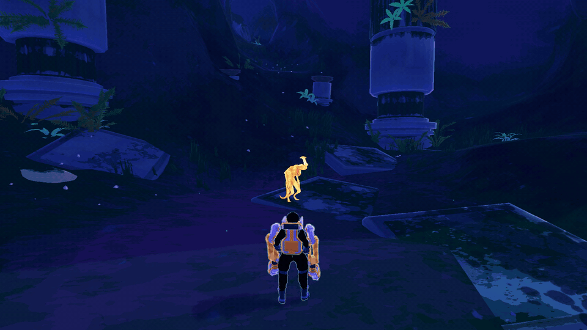
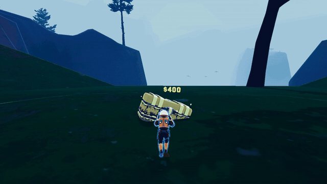
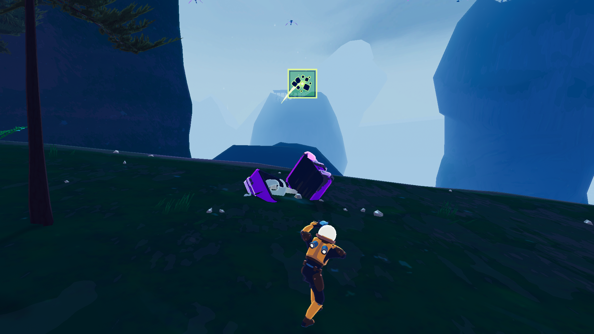
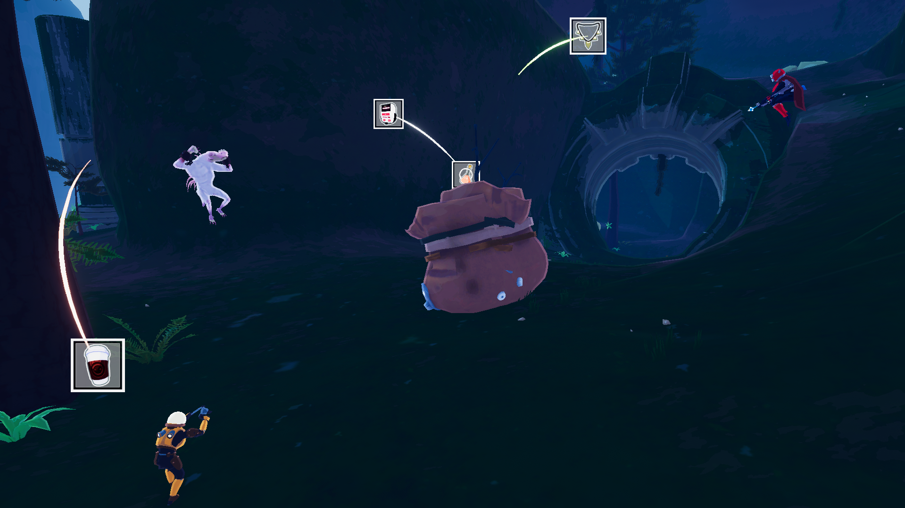

# AutoLootDistribution

Ends the "whose item is this?" question in multiplayer, especially with the **Artifact of Sacrifice**.
A dropped item flies to the player who earned it, with the same animation as items taken by Mithrix or the Hex of Greed,
and is picked up automatically.

**Host-side**: only the host needs the mod.

**Recommended:** play together with **[JustDropItems by H1xl](https://thunderstore.io/c/riskofrain2/p/H1xl/JustDropItems/)**, so players can drop or pass items to each other.

## Screenshots

## Features
- **Items fly to the player who earned them**: from monster kills, chests, shrines, printers, scrappers, the Wandering
  CHEF and other sources, to the killer, opener or user. Kills by drones, turrets and other minions count for their
  owner.
- **Every source has its own setting**: give its items to the owner, the nearest player, a random player, players in
  turn, or the player with the fewest items of that tier. Or leave them on the ground.
- **Artifact of Command**: the command cube moves to the player's feet, so they still choose the item.
- **Choices fly to you**: the item you choose from a command cube, a Void Potential or another "choose one" orb.
  The orbs themselves stay where they are.
- **Item filter** by tier and by name: situational items, such as Bustling Fungus, stay on the ground.
- **No item is lost**: items still flying when the stage ends are given at once; if the recipient leaves, the item
  drops where they were.
- **Works with JustDropItems**: items from printers and the Recycler keep their marks, so they behave the same when
  dropped again.

## Installation
Install with **r2modman** or **Thunderstore Mod Manager**. [Risk Of Options](https://thunderstore.io/c/riskofrain2/p/Rune580/Risk_Of_Options/) is optional: with it, every setting can be changed in game.

## Configuration
Settings are in `BepInEx/config/com.H1xl.AutoLootDistribution.cfg` (or the mod manager's **Config editor**).
The file appears after the first launch. With Risk Of Options they are also in **Settings → Mod Options → AutoLootDistribution**.
Changes apply at once, without a restart. Only the host's settings matter.

### 1. General
| Setting | Default | Description |
|---|---|---|
| `Enabled` | `true` | Turns the mod on or off. |

### 2. Delivery
| Setting | Default | Description |
|---|---|---|
| `FlyingItemAnimation` | `true` | The item flies to the player as an icon. If off, it is given instantly. |
| `AnimationDuration` | `1` | Flight time in seconds, `0.1`–`5`. |
| `PickupNotification` | `true` | The usual pickup popup, chat line and pickup effects (such as Substandard Duplicator). |
| `MoveCommandCubesToPlayer` | `true` | Artifact of Command: the command cube (item or equipment) moves to the recipient's feet. If the recipient is dead, it stays where it dropped. If off, cubes always stay where they dropped. |
| `CommandCubeIcons` | `true` | Artifact of Command: a flying command cube looks like a cube in its tier colour. Only for players who have the mod. |
| `AutoPickupChoices` | `true` | The item chosen from a command cube, Void Potential or other "choose one" orb (Void Fields, The Wake, Halcyon Shrine) flies to the player who chose it. Equipment still drops, so your current equipment isn't replaced. |

### 3. Recipients
| Setting | Default | Description |
|---|---|---|
| `GiveToDeadPlayers` | `true` | Dead players still get their items. If off, a dead owner counts as unavailable and `Fallback` is used. |
| `SkipDisconnectedPlayers` | `true` | Players who left the game get nothing. |

### 4. Sources
Sections 4.1–4.7 have one setting per source. Each takes one of these values:
- `Disabled`: the item stays on the ground.
- `Owner`: the killer, or the player who opened, used or cooked at it.
- `Nearest`: the player closest to the drop.
- `Random`: a random player.
- `RoundRobin`: players take turns.
- `Balanced`: the player with the fewest items of that tier.

Boss rewards, events and unknown sources have no owner: with `Owner`, their items go to `Fallback`.

#### 4.1 Sources - Monsters
| Setting | Default | Items from |
|---|---|---|
| `MonsterKills` | `Owner` | Killed monsters (Artifact of Sacrifice). |
| `SonorousWhispers` | `Owner` | Sonorous Whispers. |
| `CraterKeys` | `Owner` | Sentry Keys, Prison Matrices and Ocular Batteries dropped by monsters in the Repurposed Crater events. Quest items: distributed only with `SkipObjectiveItems` off and their tier in `Tiers`. |
| `Mimics` | `Owner` | The chest reward a killed Mimic drops (Hex of Mimicry). Items a Mimic stole always go back to their owners on their own. |
| `SolusExtractors` | `Owner` | Temporary copies of stolen items a killed Solus Extractor drops; they go to the player it stole from. The item filter isn't used. |

#### 4.2 Sources - Chests
| Setting | Default | Items from |
|---|---|---|
| `Chests` | `Owner` | Small, large, legendary, category and cloaked chests, and other chests. |
| `LunarPods` | `Disabled` | Lunar Pods. |
| `VoidCradles` | `Disabled` | Void Cradles. |
| `RustedLockboxes` | `Owner` | Rusted Key lockboxes. |
| `EncrustedLockboxes` | `Disabled` | Encrusted Key lockboxes. |
| `AdaptiveChests` | `Owner` | Adaptive Chests. |
| `ScavengerBags` | `Disabled` | Scavenger's Sacks (the lunar Scavenger's too). |

#### 4.3 Sources - Shrines
| Setting | Default | Items from |
|---|---|---|
| `ShrinesOfChance` | `Owner` | Shrines of Chance. |
| `CleansingPools` | `Owner` | Cleansing Pools. |
| `CharityNodes` | `Owner` | Charity Nodes. |

#### 4.4 Sources - Shops and crafting
| Setting | Default | Items from |
|---|---|---|
| `Printers` | `Owner` | 3D Printers. |
| `Scrappers` | `Owner` | Scrappers. |
| `DroneScrappers` | `Owner` | Drone Scrappers: the scrap for a scrapped drone. |
| `Multishops` | `Owner` | Multishop Terminals, Shipping Request Form deliveries, other shop terminals. |
| `Cauldrons` | `Owner` | Cauldrons in the Bazaar Between Time. |
| `BazaarLunarShop` | `Disabled` | The lunar shop in the Bazaar Between Time. |
| `WanderingChef` | `Owner` | Dishes cooked by the Wandering CHEF. The item filter isn't used: the player chose the recipe. |
| `WanderingChefProtectFromCorruption` | `true` | Not a source: if the recipient has the void item that would corrupt the dish, it stays on the ground so another player can take it. If off, it is always given. |

#### 4.5 Sources - Events
| Setting | Default | Items from |
|---|---|---|
| `BossRewards` | `Disabled` | Teleporter and other boss rewards. |
| `TheWake` | `Disabled` | Rewards of The Wake. |
| `TotemOfSacrifice` | `Disabled` | Rewards of the Totem of Sacrifice altar. |

#### 4.6 Sources - Survivors and drones
| Setting | Default | Items from |
|---|---|---|
| `Drifter` | `Owner` | Temporary items the Drifter makes with Salvage and Tinker; they go to that Drifter. The item filter isn't used. Items players put into the Drifter's hoard and get back are never moved. |
| `JunkDrone` | `Owner` | Temporary items from a Junk Drone's Surprise!; they go to the drone's owner. |

#### 4.7 Sources - Unknown
| Setting | Default | Items from |
|---|---|---|
| `UnknownSources` | `Disabled` | Anything else: other events and objects, items dropped by other mods. The item filter still applies. |

### 5. Item filter
| Setting | Default | Description |
|---|---|---|
| `Tiers` | `Tier1, Tier2, Tier3, Boss` | Item tiers that may be distributed: `Tier1` (white), `Tier2` (green), `Tier3` (red), `Boss` (yellow), `Lunar`, `VoidTier1`, `VoidTier2`, `VoidTier3`, `VoidBoss`, `FoodTier`, `Cursed`, `Page`, `Hex`, `NoTier`. Modded tiers by their name. |
| `SkipObjectiveItems` | `false` | If on, quest and key items stay on the ground, so anyone can carry them: Artifact Key, Prison Matrix, Sentry Key, Ocular Battery, Encrypted Cerebellum, Exposed Cerebellum, Peace Flower. |
| `ItemListEnabled` | `true` | Use the item list. |
| `IgnoreItemListInSingleplayer` | `true` | In single player the list isn't used: there is nobody to share with. |
| `ItemListMode` | `Exclude` | `Exclude`: listed items stay on the ground. `IncludeOnly`: only listed items are distributed. |
| `ItemList` | situational items | Comma-separated item names, English (`Bustling Fungus`) or internal (`Mushroom`). Default: Bustling Fungus, Rejuvenation Rack, Spare Drone Parts, Box of Dynamite, Lysate Cell, Shatterspleen, Rose Buckler, Ignition Tank, H3AD-5T v2, Purity, Collector's Compulsion. |

With the Artifact of Command, `Tiers` and `SkipObjectiveItems` still apply to command cubes, but the item list doesn't: the player chooses the item.

### 6. Fallback
| Setting | Default | Description |
|---|---|---|
| `Fallback` | `Disabled` | For all sources: who gets the item when the source's method finds nobody (the owner is dead or left, the monster died to the environment, or the source has no owner). `Disabled`, `Nearest`, `Random`, `RoundRobin` or `Balanced`. A source set to `Disabled` always stays on the ground. |

### 7. Debug
| Setting | Default | Description |
|---|---|---|
| `VerboseLogging` | `true` | Logs every distributed item: source, recipient and method. Useful for reporting problems. |
| `DuplicatorSkipsHexAndKeyItems` | `false` | Changes the game's own rules: Substandard Duplicator gives no temporary copy for Hex items and quest/key items (Sentry Key, Prison Matrix, Ocular Battery and others). In the game it does; this applies to items picked up from the ground too. |

## Multiplayer
Only the host needs the mod; everyone else can play without it and sees the game's own item-transfer animation.
Only the host's settings matter.
With the Artifact of Command, players who also have the mod see flying command cubes as cubes in their tier colour.
Players without it see Item Scrap of the cube's tier, Strange Scrap for void tiers and a Fuel Array for equipment.

## Known limitations
- Equipment is only moved inside command cubes; other equipment drops stay on the ground, so nobody's equipment is replaced.
- Items from the Artifact of Delusion and Lunar Coins are never touched.
- Chests and shop terminals from other mods count as `Chests` or `Multishops`. Other modded drops count as `UnknownSources`.
- Playing the **Drifter** the way the developers intended may become impossible: the mod leaves almost no items on the
  ground, and some of the Drifter's abilities work only with items lying there. **[JustDropItems by H1xl](https://thunderstore.io/c/riskofrain2/p/H1xl/JustDropItems/)**
  fixes this: drop the item you need and use it.
- Don't use it together with other auto-pickup or item-sharing mods, such as AutoItemPickup or ShareSuite: both would
  handle the same drops.

## Reporting problems
Open an issue at <https://github.com/H1xl/AutoLootDistribution/issues> with the mod version, your mod list (or the mod
manager's profile code), `BepInEx/LogOutput.log` from a game where it happened (turn on `VerboseLogging` first), the
steps, and what you expected.

## Credits
- Mod icon: "Mine." cat picture, via **Lol Damn** at [cheezburger.com](https://cheezburger.com)

This is a free fan mod and is not affiliated with Hopoo Games / Gearbox.
